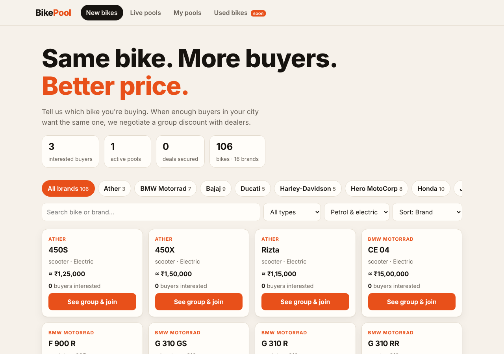
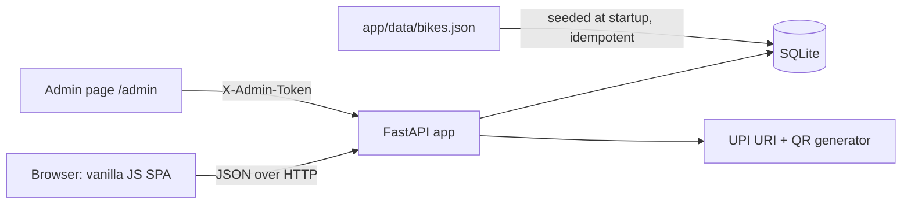
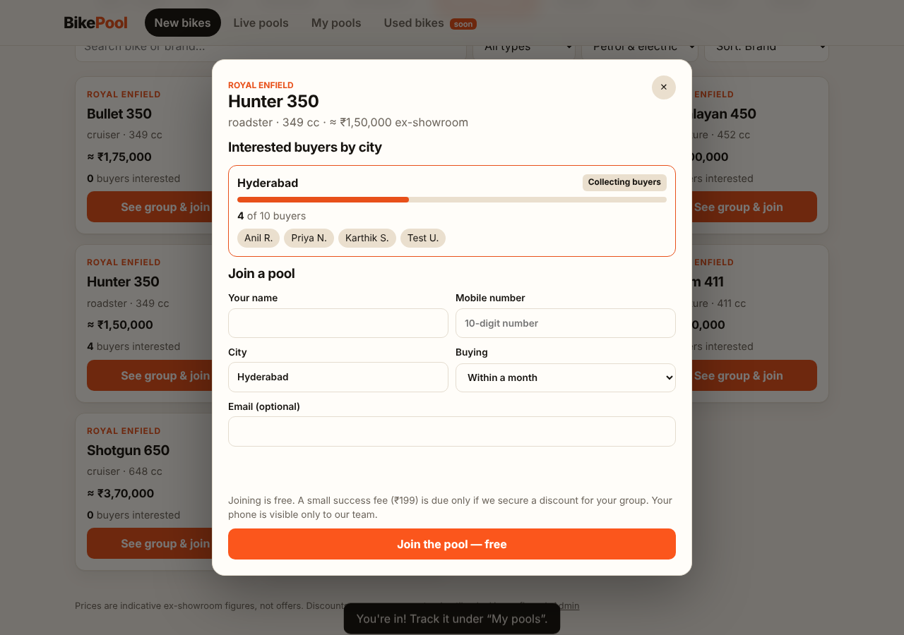
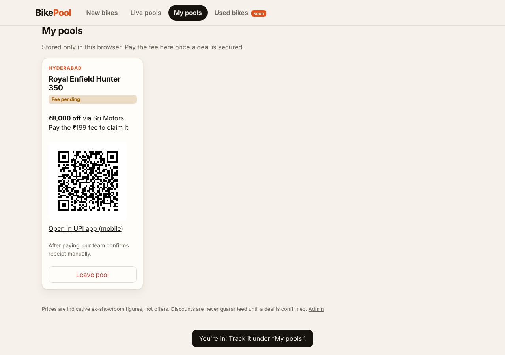

# BikePool: group buying for bikes

   

BikePool lets buyers of the **same bike in the same city** pool together. When a group is big enough, the platform negotiates a group discount with a dealer. The platform earns a small **success fee** only when a discount is actually secured.

> **Status: Day 1 milestone (new bikes).** The used-bike marketplace is planned for the next milestone; the UI has a placeholder tab for it.



## Problem statement

Individual buyers have no negotiating power at a showroom, while a visible group of buyers asking for the same model does. Today these buyers never find each other. BikePool makes the demand visible and gives a negotiator (the admin) a ready-made group to take to a dealer.

## Objectives

- Browse every bike under its **brand** (16 brands, 106 models: Honda, Royal Enfield, Bajaj, Suzuki, BMW, TVS, Hero, Yamaha, KTM, Kawasaki, Triumph, Ducati, Harley-Davidson, Jawa/Yezdi, Ola Electric, Ather).
- Let a buyer join a per-bike, per-city pool for free and see who else is interested.
- Give an admin a console to record the negotiated deal and confirm fee payments.
- Charge the platform fee **only after** a deal exists, via a UPI QR (no payment gateway needed).

## Features

| Area | What it does |
|---|---|
| Catalog | Brand chips, search, type/fuel filters, sort by price or most-interested |
| Pools | One pool per (bike, city); progress bar toward a target size; public buyer list shows only `Rahul K.`-style names |
| Join | Validated Indian mobile number, duplicate-phone protection, buying timeline |
| My pools | Buyer's memberships (stored in the browser), fee status, UPI QR when a fee is due, leave pool |
| Admin | Token-protected: set status, target, dealer, discount, validity; mark fees paid; see full contact details |
| Used bikes | **Not built yet** (placeholder tab only) |

## Architecture



**Data flow (join):** the browser POSTs `/api/pools/join` → input is validated and normalised (city title-cased, phone reduced to 10 digits) → the pool for `(bike, city)` is found or created → the member row is inserted with a random secret → the secret is returned once and kept in `localStorage`, then used as the `X-Member-Secret` header for that buyer's own fee and leave calls.

**Fee flow:** `not_due` (joining) → admin sets the pool to `deal_secured` with dealer + discount → all members become `pending` → buyer opens *My pools*, scans the UPI QR → admin verifies the receipt in their bank app and clicks *Mark paid*. The app never touches money.

## Technology stack

FastAPI, Pydantic v2, SQLite (stdlib `sqlite3`), `qrcode`, vanilla JS/CSS, pytest + httpx, ruff, Docker, GitHub Actions.
*Alternatives considered:* PostgreSQL + React (heavier setup, better for scale), Django (built-in admin, but a bigger framework than this milestone needs).

## Prerequisites

Python 3.11+ (developed on 3.13). Docker is optional.

## Repository structure

```
app/            FastAPI app (main.py), schema/validation, DB layer, UPI helper, config
app/data/       bikes.json: the brand/model catalog (edit to change prices/models)
static/         index.html, admin.html, app.js, admin.js, style.css
tests/          pytest API tests (fresh SQLite file per test)
docs/screenshots/
.github/workflows/ci.yml
```

## Installation and setup

**Windows PowerShell**
```powershell
git clone https://github.com/Maheshirlapalle/Bike-Pool.git
cd Bike-Pool
python -m venv .venv
.\.venv\Scripts\Activate.ps1
pip install -r requirements-dev.txt
Copy-Item .env.example .env        # then edit .env
```

**Linux / macOS**
```bash
git clone https://github.com/Maheshirlapalle/Bike-Pool.git && cd Bike-Pool
python3 -m venv .venv && source .venv/bin/activate
pip install -r requirements-dev.txt
cp .env.example .env               # then edit .env
```

### Environment variables

| Variable | Default | Meaning |
|---|---|---|
| `ADMIN_TOKEN` | *(empty)* | Required for `/admin`. If empty, admin endpoints return 503. |
| `PLATFORM_UPI_ID` | `bikepool@upi` | UPI ID that receives the fee. Set your own. |
| `PLATFORM_PAYEE_NAME` | `BikePool` | Name shown in the UPI app |
| `PLATFORM_FEE_INR` | `199` | Success fee per buyer |
| `BIKEPOOL_DB` | `data/bikepool.db` | SQLite path |

The app does not load `.env` itself; export the variables or use Docker Compose (which reads `.env`).

## Run

**PowerShell**
```powershell
$env:ADMIN_TOKEN = "choose-a-long-random-string"
uvicorn app.main:app --reload --port 8000
```
**Linux / macOS**
```bash
ADMIN_TOKEN=choose-a-long-random-string uvicorn app.main:app --reload --port 8000
```
Open <http://localhost:8000> (buyers) and <http://localhost:8000/admin> (admin). Interactive API docs: <http://localhost:8000/docs>.

**Docker** (written but not yet executed in the build environment; verify locally):
```bash
docker compose up --build
```

## Usage walkthrough

1. Open the site → pick **Royal Enfield** → **Hunter 350** → *See group & join*.
2. Enter name, mobile, city (`Hyderabad`) → *Join the pool*. You appear in the buyer list as `Name X.`.
3. Open `/admin`, enter the token, set the pool to `deal_secured` with a dealer and discount → *Save*.
4. Back in *My pools*, the fee card now shows a UPI QR. After "payment", click *Mark paid* in admin.




## API documentation

| Method & path | Auth | Purpose |
|---|---|---|
| `GET /api/brands`, `/api/categories`, `/api/stats` | none | Catalog and totals |
| `GET /api/bikes?brand=&category=&fuel=&q=&sort=` | none | List bikes with interested-buyer counts |
| `GET /api/bikes/{id}` | none | Bike + its open pools |
| `GET /api/pools?city=&status=` | none | Active pools, biggest first |
| `GET /api/pools/{id}` | none | Pool + masked buyer list |
| `POST /api/pools/join` | none | Join (creates the pool if needed); returns `member_secret` once |
| `GET /api/members/{id}/fee` | `X-Member-Secret` | Fee status; UPI URI + QR when pending |
| `DELETE /api/members/{id}` | `X-Member-Secret` | Leave pool (blocked once fee is paid) |
| `GET /api/admin/pools` | `X-Admin-Token` | All pools with full member contact details |
| `PATCH /api/admin/pools/{id}` | `X-Admin-Token` | Update status/target/dealer/discount/validity |
| `POST /api/admin/members/{id}/mark-paid` | `X-Admin-Token` | Confirm fee receipt |

```bash
curl -X POST localhost:8000/api/pools/join -H "Content-Type: application/json" \
  -d '{"bike_id":1,"city":"Hyderabad","name":"Rahul Kumar","phone":"9876543210","timeline":"1_month"}'
```

## Testing

```bash
pytest -q          # 25 tests
ruff check . && ruff format --check .
```
Result when run during development: **25 passed**, ruff clean. Tests cover catalog filters, seed idempotency, join/validation/duplicate handling, privacy of the public list, the whole fee lifecycle, auth failures, and member-secret checks. The UI was additionally exercised once with a headless Chromium script (browse, join, validation error, admin deal, QR shown, no horizontal scroll at 390px); that script is not part of the repo, so there are no automated frontend tests yet.

## CI/CD

`.github/workflows/ci.yml` runs on push/PR: **lint** (ruff) → **tests** (pytest) → **dependency audit** (`pip-audit`) → **Docker build**. The workflow has not been run on GitHub yet; check the *Actions* tab after your first push.

## Security considerations

- Public pool pages expose only `First L.` names; phone/email are visible only through the admin API.
- Admin token and member secrets are compared with `secrets.compare_digest`; admin is **disabled** unless `ADMIN_TOKEN` is set.
- The member-secret failure response is the same for "no such member" and "wrong secret" so ids can't be probed.
- All SQL is parameterised; the one dynamic `UPDATE` builds column names only from validated model fields.
- The frontend inserts user text with `textContent` only (no `innerHTML`), preventing stored XSS.
- Container runs as a non-root user.
- **Not implemented:** rate limiting, OTP verification of phone numbers, HTTPS (terminate TLS at a reverse proxy), admin login sessions, CSRF concerns do not apply because auth uses custom headers rather than cookies.
- **Personal data:** you collect phone numbers. Before going live, add a privacy notice and consent text (India's DPDP Act applies); this is not legal advice.

## Limitations and future improvements

- **Used-bike marketplace** (sellers listing old bikes, same brand → model structure): next milestone.
- Prices in `bikes.json` are indicative, rounded, and **not verified live ex-showroom prices**; update them before relying on them.
- No phone verification, so fake sign-ups are possible; add OTP.
- Fee confirmation is manual (admin checks the bank app). A payment gateway can replace this later.
- SQLite is fine for a single instance; move to PostgreSQL to scale out.
- Business reality: the discount depends on dealers agreeing. The software does not create discounts, it organises demand.

## Cleanup

```bash
docker compose down -v      # if using Docker (removes the data volume)
rm -rf .venv data           # PowerShell: Remove-Item -Recurse -Force .venv, data
```

## Cost

Runs locally for free. Hosting a single small VM or PaaS instance is typically a few dollars per month (check current provider pricing).

## Learning outcomes

REST API design with FastAPI, input validation and normalisation, relational modelling (brand → bike → pool → member), secret handling, privacy-aware public views, UPI deep links/QR, API testing with isolated databases, and designing a fee model that aligns with user trust.

## Resume-ready description

*Built BikePool, a full-stack group-buying platform for motorcycles (FastAPI, SQLite, vanilla JS): city-wise buyer pools over a 16-brand / 106-model catalog, privacy-masked buyer lists, an admin deal console, and a success-fee flow using UPI QR codes; 25 automated API tests and a GitHub Actions pipeline.*

## License and contributing

MIT; see [LICENSE](LICENSE). Issues and PRs welcome: run `pytest` and `ruff` before opening a PR.
